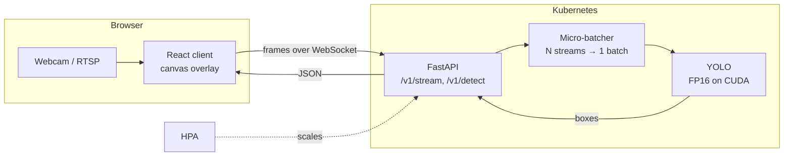

# AI Multimodal Assistant

[](https://github.com/mohammadazam7/ai_multimodal_assistant/actions/workflows/ci.yml)


[](LICENSE)

Real-time object detection on live camera feeds. A FastAPI service runs a YOLO model
(FP16 on GPU), a React client streams webcam frames and draws the detections, and the
service is built to batch frames from many cameras into one forward pass and scale out
on Kubernetes.

> **Status:** under active development. The detection service, multi-stream batching,
> the web client, observability and the Kubernetes deployment are done; see the
> [roadmap](docs/ROADMAP.md) for benchmarks.

## Architecture



## API

| Method | Path | Body | Returns |
|---|---|---|---|
| `GET` | `/healthz` | – | liveness: model, device, readiness flag (always `200`) |
| `GET` | `/readyz` | – | readiness checks; `503` when the service should not get traffic |
| `GET` | `/metrics` | – | Prometheus metrics |
| `POST` | `/v1/detect` | `multipart/form-data` with `file` | detections + timings |
| `POST` | `/v1/detect/base64` | `{"image": "data:image/jpeg;base64,..."}` | detections + timings |
| `WS` | `/v1/stream` | one binary message (JPEG/PNG) per frame | one JSON result per processed frame |

Example response:

```json
{
  "detections": [
    {"label": "person", "confidence": 0.91, "box": {"x1": 12.0, "y1": 30.5, "x2": 210.4, "y2": 470.0}}
  ],
  "width": 640, "height": 480,
  "model": "yolov8n.pt (fp16)",
  "inference_ms": 7.8,
  "total_ms": 11.2
}
```

Each response reports `inference_ms` (batch wait + forward pass) and `total_ms`
(decode → batch → inference → post-processing), so latency can be measured from the
client without extra tooling. Interactive docs are served at `/docs`.

### Live streams

A camera opens one WebSocket to `/v1/stream` and sends frames as binary messages. Each
result carries the same fields as above plus `seq` (which frame it belongs to, counting
from 1 on that connection) and `dropped` (how many frames the server has skipped so
far because newer ones arrived while the model was busy).

```python
import asyncio, websockets

async def main() -> None:
    async with websockets.connect("ws://localhost:8000/v1/stream") as ws:
        await ws.send(open("frame.jpg", "rb").read())
        print(await ws.recv())  # {"seq": 1, "dropped": 0, "detections": [...], ...}

asyncio.run(main())
```

A frame that can't be decoded gets `{"seq": n, "error": "..."}` and the stream keeps
going. Text messages close the socket with code 1003, frames over the size limit with
1009, and a model failure with 1011.

## Run it

```bash
cd backend
python -m venv .venv && source .venv/bin/activate

# API + tests only (no torch, starts in seconds; returns no detections)
pip install -e ".[dev]"
VISION_DETECTOR=null uvicorn app.main:app --reload

# Full inference stack (downloads yolov8n weights on first start)
pip install -e ".[inference]"
uvicorn app.main:app
```

```bash
curl -F file=@street.jpg http://localhost:8000/v1/detect
```

Web client (in a second terminal, with the API on port 8000):

```bash
cd frontend
npm install
npm run dev   # http://localhost:5173
```

Pick a camera and press **Add camera**; add the same or another camera again to open
more streams. Each tile shows its own FPS, browser-measured p50/p95 round trip, the
server-side time and how many frames the server dropped. The dev server proxies `/v1`
and `/healthz` to the API, so no CORS setup is needed.

Docker:

```bash
docker build -t vision-service backend
docker run -p 8000:8000 -v vision-models:/models vision-service
```

The image downloads the weights to `/models` on first start; mounting a volume there
keeps them across restarts.

Or run the whole stack (API, web client with hot reload, Prometheus) with Compose:

```bash
docker compose up --build
# API :8000, client :5173, Prometheus :9090
VISION_DETECTOR=null docker compose up --build   # skip the model download
```

### Kubernetes

Manifests live in `deploy/k8s` as a Kustomize base with two overlays:

| Overlay | Image tag | Node | Scales on |
|---|---|---|---|
| `overlays/cpu` | `cpu` | any; requests 2 cores, limit 4 | CPU at 70 % or 4 open streams per pod, 1–8 pods |
| `overlays/gpu` | `gpu` | NVIDIA GPU with the device plugin, one GPU per pod | 16 open streams per pod, 1–4 pods |

```bash
# images: the CPU wheel index is the default, pass the CUDA one for the GPU tag
docker build -t ghcr.io/mohammadazam7/vision-service:cpu backend
docker build -t ghcr.io/mohammadazam7/vision-service:gpu \
  --build-arg TORCH_INDEX=https://download.pytorch.org/whl/cu124 backend

kubectl apply -k deploy/k8s/overlays/cpu
kubectl -n vision port-forward svc/vision-service 8000:80
```

What the manifests do:

- **Probes match the endpoints.** A startup probe on `/readyz` gives the first start up
  to five minutes to download the weights; after that, readiness uses `/readyz` and
  liveness uses `/healthz`, so a pod that is draining or still loading is taken out of
  the Service without being restarted.
- **Rollouts keep capacity.** `maxUnavailable: 0` with `maxSurge: 1` means a new pod has
  to pass readiness before an old one is removed. A short `preStop` sleep lets the
  endpoint removal reach the load balancer before uvicorn stops accepting connections.
- **The HPA owns the replica count.** The Deployment sets no `replicas`, so `kubectl
  apply` never resets what the autoscaler chose. Scale-down is slow (one pod every two
  to five minutes after a five to ten minute window) because removing a pod drops its
  WebSocket clients, which then have to reconnect.
- **Two autoscaling signals.** CPU alone reacts late to streaming load: a new camera
  connects first and the CPU follows a few seconds later. The custom
  `vision_streams_in_flight` metric is served to the HPA by
  [prometheus-adapter](deploy/k8s/prometheus-adapter/values.yaml); the HPA takes the
  larger of the two proposals. On GPU pods CPU says little about headroom, so only the
  stream count is used. The per-pod targets are starting points until the M6 benchmark
  gives measured numbers.
- **Locked-down pods.** Non-root user, read-only root filesystem, all capabilities
  dropped, `RuntimeDefault` seccomp, and a PodDisruptionBudget so a node drain evicts
  one pod at a time.

CI renders both overlays and validates them with `kubeconform` against Kubernetes 1.30,
and checks the Compose file with `docker compose config`.

### Configuration

| Variable | Default | Meaning |
|---|---|---|
| `VISION_DETECTOR` | `yolo` | `yolo` or `null` |
| `VISION_MODEL_PATH` | `yolov8n.pt` | any Ultralytics model |
| `VISION_DEVICE` | `auto` | `auto`, `cpu`, `cuda`, `cuda:1`, ... |
| `VISION_HALF_PRECISION` | `true` | FP16 inference on CUDA |
| `VISION_CONFIDENCE` | `0.5` | minimum score |
| `VISION_MAX_IMAGE_BYTES` | `8388608` | larger uploads get `413`, larger stream frames close with 1009 |
| `VISION_BATCH_MAX_SIZE` | `8` | most frames in one forward pass |
| `VISION_BATCH_MAX_WAIT_MS` | `5` | longest a frame waits for others to join its batch |
| `VISION_LOG_LEVEL` | `INFO` | root log level |
| `VISION_LOG_FORMAT` | `json` | `json` (one object per line) or `text` |

## Observability

`/metrics` exposes these series for Prometheus (each app instance has its own registry):

| Metric | Type | What it shows |
|---|---|---|
| `vision_detect_seconds{source}` | histogram | frame received → detections ready, decode included; `source` is `http` or `stream` |
| `vision_inference_seconds` | histogram | one forward pass over a batch |
| `vision_batch_size` | histogram | frames per forward pass |
| `vision_batch_queue_depth` | gauge | frames waiting for the batcher, read at scrape time |
| `vision_batch_failures_total` | counter | forward passes that raised |
| `vision_frames_total{source,outcome}` | counter | frames handled, `outcome` is `ok` or `invalid` |
| `vision_stream_frames_dropped_total` | counter | stream frames replaced by a newer one before inference |
| `vision_streams_in_flight` | gauge | open WebSocket streams |

Useful queries:

```promql
# p95 end-to-end latency per source over 5 minutes
histogram_quantile(0.95, sum by (le, source) (rate(vision_detect_seconds_bucket[5m])))

# average frames per forward pass (how much batching is actually happening)
rate(vision_batch_size_sum[5m]) / rate(vision_batch_size_count[5m])

# share of stream frames skipped because the model fell behind
rate(vision_stream_frames_dropped_total[5m])
  / (rate(vision_stream_frames_dropped_total[5m]) + rate(vision_frames_total{source="stream"}[5m]))
```

Logs go to stdout as one JSON object per line. Every HTTP request is logged once with
an id, which is also returned in the `X-Request-ID` response header (an incoming
`X-Request-ID` from a proxy is reused):

```json
{"ts": "2026-10-15T23:18:10.847+00:00", "level": "info", "logger": "app.access", "msg": "POST /v1/detect 200", "request_id": "98577a6e3dcd4280afbbcf1e0fd17500", "method": "POST", "path": "/v1/detect", "status": 200, "duration_ms": 129.4}
```

Requests to `/healthz`, `/readyz` and `/metrics` are logged at debug so probes and
scrapes don't drown everything else. Streams log when they open and close, with the
number of frames dropped.

`/healthz` and `/readyz` answer different questions. `/healthz` is liveness: it returns
`200` as long as the process can serve HTTP, so an orchestrator only restarts the
container when it is truly stuck. `/readyz` is readiness: it returns `503` and lists
the failing check when the model is not loaded, the batcher is not running, or the
service is shutting down, so traffic is moved away without a restart.

```json
{"ready": true, "checks": {"model_loaded": true, "batcher_running": true, "not_draining": true}}
```

## Design notes

- **Batch-first detector interface.** `Detector.predict` takes a list of frames, so the
  multi-stream batcher plugs in without changing the API or the model code.
- **Micro-batching across streams.** HTTP requests and WebSocket frames all go through
  one batcher. It starts a forward pass as soon as `VISION_BATCH_MAX_SIZE` frames are
  waiting or the first one has waited `VISION_BATCH_MAX_WAIT_MS`, whichever comes first.
  On a GPU this trades a few milliseconds of waiting for far fewer kernel launches.
- **Drop stale frames, don't queue them.** Each stream holds only its newest unprocessed
  frame. If the model falls behind, older frames are overwritten and counted, so latency
  stays bounded and the boxes always describe a recent picture. A queue would instead
  grow without limit and show detections for frames from seconds ago.
- **Inference off the event loop.** The forward pass runs in a worker thread, so slow
  frames don't block health checks or other requests.
- **Torch is optional.** The API, validation and tests install without the inference
  stack, which keeps CI fast. The `null` detector lets the web client be developed
  without a GPU.
- **One frame in flight per camera.** The client encodes the next frame only after the
  previous result arrives, so a slow server lowers the frame rate instead of growing a
  queue, and the measured round trip never includes time spent behind older frames.
  Frames are downscaled to 640 px wide JPEG before upload; the overlay rescales the
  boxes to whatever size the tile is drawn at.
- **Fail loudly on bad input.** Non-images return `415`, bad base64 returns `422`, and
  oversized uploads return `413`, instead of a `200` with an error string.

## Development

```bash
cd backend
pip install -e ".[dev]"
ruff check . && ruff format --check . && mypy app && pytest
```

## License

MIT © Mohammad Azam
