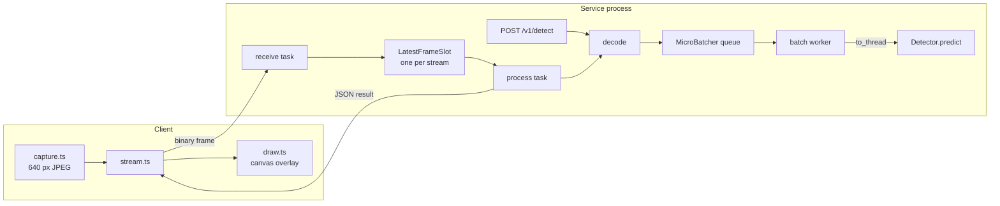

# Architecture

This document describes how the vision service is structured, how a frame moves through
it, and why the main design choices were made. It is written for someone who will
operate the service or change its code. The README covers installation and the API
surface; [BENCHMARKS.md](BENCHMARKS.md) covers measured performance.

## Overview

The system runs object detection on live camera feeds. It has three parts:

| Part | Location | Responsibility |
|---|---|---|
| Detection service | `backend/app` | FastAPI application: decodes frames, batches them across callers, runs the detector, returns boxes |
| Web client | `frontend/src` | Captures webcam frames, sends them over a WebSocket, draws the returned boxes on a canvas |
| Deployment | `deploy/` | Kustomize base and CPU/GPU overlays, HorizontalPodAutoscaler, prometheus-adapter rules, Prometheus config for local use |

The service is a single Python process per pod. All concurrency inside it is cooperative
(one asyncio event loop) except the forward pass, which runs in a worker thread.

## Components

### Detector (`app/detector.py`)

`Detector` is a `Protocol` with one method, `predict(frames) -> list[list[Detection]]`.
It takes a list so that every implementation is batch-capable by construction.
Two implementations exist:

- `YoloDetector` wraps an Ultralytics model. Device selection (`VISION_DEVICE=auto`)
  picks CUDA when available. `VISION_HALF_PRECISION` applies only on CUDA; on CPU the
  model always runs in FP32.
- `NullDetector` returns no detections. It lets the API, the web client and CI run
  without PyTorch installed.

### Micro-batcher (`app/batching.py`)

`MicroBatcher` sits between all request handlers and the detector. Callers
`await submit(frame)`; each call enqueues a `(frame, future)` pair and waits on the
future. A single worker task:

1. Blocks on the queue for the first frame and starts a deadline of
   `VISION_BATCH_MAX_WAIT_MS`.
2. Keeps taking frames until the batch reaches `VISION_BATCH_MAX_SIZE` or the deadline
   passes. At the deadline it still drains frames already queued, since including them
   costs no extra wait.
3. Discards entries whose futures were cancelled (the client went away).
4. Runs `detector.predict` in a worker thread via `asyncio.to_thread`, then resolves each
   future with its own result, or sets the same exception on all of them.

Exactly one forward pass is in flight at a time. This keeps device memory use
predictable and makes the batch size, not the number of threads, the unit of
parallelism. On shutdown, `stop()` cancels the worker and fails every pending future
with `BatcherClosedError`, so no handler waits forever.

### Stream handler (`app/main.py`, `app/streams.py`)

Each WebSocket connection runs two tasks:

- **receive** reads binary messages, assigns a sequence number and puts the frame into a
  `LatestFrameSlot`. It enforces the size limit (close 1009) and rejects text messages
  (close 1003).
- **process** takes the newest frame from the slot, sends it through the batcher and
  writes the JSON result.

`LatestFrameSlot` holds at most one frame. A `put` while a frame is already waiting
overwrites it and increments `dropped`. When either task finishes, the other is
cancelled; a failure other than a client disconnect closes the socket with 1011.

### HTTP endpoints

`/v1/detect` and `/v1/detect/base64` decode the image and submit it to the same batcher
as the streams, so single images and live frames share one queue and one forward pass.
Invalid input is rejected before it reaches the batcher (`413`, `415`, `422`).

### Lifecycle and health

The FastAPI lifespan builds the detector, starts the batcher and registers the queue
depth gauge. On shutdown it first sets `draining`, which makes `/readyz` return `503`,
and then stops the batcher. `/healthz` reports only that the process can serve HTTP;
`/readyz` checks that the model is loaded, the batcher is running and the service is
not draining. Kubernetes uses the first for liveness and the second for readiness and
startup.

### Observability (`app/metrics.py`, `app/logs.py`, `app/access.py`)

Each application instance owns its own Prometheus registry, which keeps tests isolated.
The batcher reports to the metrics object through the `BatchObserver` protocol, so the
batching module has no dependency on Prometheus. Logs are JSON lines on stdout with a
per-request id propagated through `X-Request-ID`.

## Life of a stream frame

1. The client captures a frame, scales it to 640 px wide, encodes JPEG and sends it as
   one binary message. It does not send the next frame until this one is answered.
2. The receive task timestamps the frame and stores it in the stream's slot, replacing
   any frame that is still waiting.
3. The process task takes the frame, decodes it and submits it to the batcher.
4. The frame waits at most `VISION_BATCH_MAX_WAIT_MS` for other frames, then goes through
   one forward pass together with them.
5. The result is returned with `seq`, `dropped`, `inference_ms` (batch wait plus forward
   pass) and `total_ms` (receive to result). The end-to-end time is also recorded in
   `vision_detect_seconds{source="stream"}`.

## Design decisions and trade-offs

**Drop stale frames instead of queueing.** A camera produces frames at a fixed rate
regardless of how fast the model is. With a FIFO queue, any sustained overload makes
latency grow without bound and the boxes describe the past. A one-frame slot bounds
latency at roughly one inference interval plus the batch wait, at the cost of a lower
effective frame rate under load. The dropped count is exposed per stream and as a
metric, so the loss is visible rather than silent. The CPU benchmark shows this
behaviour: at 8 streams throughput plateaus near 11 fps and p95 stays under 1 s.

**Time-and-size bounded batching.** Batching amortises per-call overhead and kernel
launches on a GPU. The wait bound caps the latency cost for the first frame in a
batch. With `VISION_BATCH_MAX_WAIT_MS=5` the added latency is small relative to a
forward pass. On CPU, where cost scales roughly linearly with batch size, batching
gives no measurable gain (see the benchmark); the default is kept because the target
deployment is GPU and the setting is a single environment variable.

**One forward pass at a time.** Running several passes concurrently on one device would
compete for the same compute and memory and make tail latency harder to reason about.
Horizontal scaling (more pods) is the mechanism for more throughput.

**Inference in a worker thread.** PyTorch releases the GIL during kernels, so running
`predict` in a thread keeps the event loop free for health checks, metrics scrapes and
WebSocket I/O while a batch runs.

**Batch-first detector protocol.** Because `predict` always takes a list, batching was
added in M2 without changing the YOLO wrapper or the HTTP handlers' contract. Tests use
fake detectors that record batch sizes.

**Optional inference stack.** PyTorch and Ultralytics are an extra (`.[inference]`).
The core package, the tests and CI install in seconds, and the null detector lets the
client be developed on any machine.

**Autoscaling on open streams.** CPU utilisation rises only after a new camera has
started sending, and on GPU nodes it says little about headroom. The
`vision_streams_in_flight` gauge, served to the HPA through prometheus-adapter, reacts
when a stream opens. The CPU overlay scales on whichever of CPU and streams asks for
more replicas; the GPU overlay uses streams only.

**Slow scale-down.** Removing a pod drops its WebSocket clients, which must reconnect.
The HPA scale-down policy is therefore conservative, and rollouts use
`maxUnavailable: 0` with a short `preStop` delay so endpoints are removed before the
process stops accepting connections.

## Limitations

- **No cross-pod session affinity.** A reconnecting client may land on a different pod.
  This is harmless because the service keeps no per-stream state beyond the connection.
- **Single model per process.** Serving several models would need one batcher per model
  and a routing field in the API.
- **Measured on CPU only.** Published numbers come from a 2-vCPU VM. GPU and FP16
  behaviour, and the per-pod HPA targets for the GPU overlay, are unmeasured.
- **No authentication or rate limiting.** The service expects to run behind an ingress
  or gateway that provides them.
- **JPEG over WebSocket.** Each frame is a full JPEG. A video codec (for example WebRTC
  with H.264) would cut bandwidth substantially but adds decode cost and complexity on
  the server.
