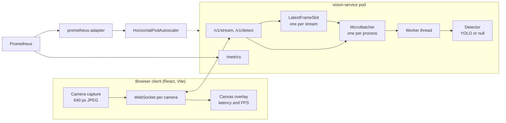
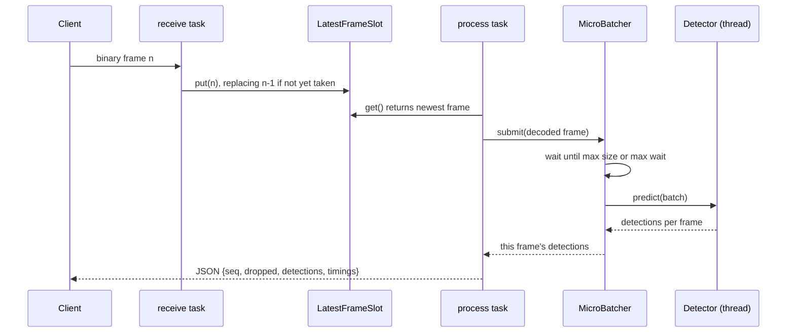

# Architecture

This document describes how the detection service is structured, how a frame moves
through it, and the trade-offs behind the main design choices. The README covers how
to run it; [BENCHMARKS.md](BENCHMARKS.md) covers what it measured.

## Goals and non-goals

Goals:

- Serve object detection to many concurrent live camera streams with bounded latency.
  A result should describe a frame that is at most one inference cycle old, however
  far the model falls behind.
- Use one accelerator efficiently by running frames from different streams in the
  same forward pass.
- Scale horizontally on Kubernetes on a signal that tracks stream load, not only CPU.
- Keep the API, transport and batching logic testable without torch or a GPU.

Non-goals:

- Tracking objects across frames, recording video or storing results. Each frame is
  answered independently and nothing is persisted.
- Guaranteed delivery. A live view prefers a fresh answer to a complete one, so frames
  are dropped under load by design.
- Authentication and multi-tenancy. The service is meant to sit behind an ingress or
  gateway that handles them.

## Components

| Component | Module | Responsibility |
|---|---|---|
| HTTP and WebSocket API | `app/main.py` | Request validation, image decode, one receive and one process task per stream, close codes. |
| Latest-frame slot | `app/streams.py` | Per-stream back-pressure: holds only the newest unprocessed frame and counts the ones it replaced. |
| Micro-batcher | `app/batching.py` | Collects frames from all callers into one batch, bounded by size and wait time, and runs it off the event loop. |
| Detector | `app/detector.py` | Batch-oriented `predict(frames)`; YOLO with FP16 on CUDA, or a null detector that returns nothing. |
| Metrics and logs | `app/metrics.py`, `app/logs.py` | Prometheus histograms and gauges; JSON logs with request context. |
| Readiness | `app/main.py` | `/healthz` reports liveness; `/readyz` returns `503` until the model is loaded and the batcher is running, and again while the pod drains. |
| Web client | `frontend/` | Webcam capture, one frame in flight per camera, box overlay rescaled to the tile size. |
| Deployment | `deploy/k8s/` | Kustomize base with CPU and GPU overlays, PodDisruptionBudget, HPA on CPU and on open streams. |
| Benchmark harness | `backend/bench/` | Replays a video as N open-loop streams and reports latency percentiles, throughput and drops. |

## Life of a stream frame

1. The receive task reads binary messages as fast as the client sends them. It never
   waits for inference, so a slow model cannot stall the socket.
2. Each frame goes into the stream's `LatestFrameSlot`. If the previous frame has not
   been taken yet it is overwritten and `dropped` increases.
3. The process task takes the newest frame, decodes it and submits it to the shared
   `MicroBatcher`, then waits for that frame's result.
4. The batcher's single worker starts a forward pass when `VISION_BATCH_MAX_SIZE`
   frames are waiting or the first frame has waited `VISION_BATCH_MAX_WAIT_MS`
   (defaults: 8 frames, 5 ms). The pass runs in a worker thread through
   `asyncio.to_thread`, so health checks and other sockets keep being served.
5. The result is sent back with `seq` and the running `dropped` count, so the client
   can tell which frame it describes and how much the server is shedding.

HTTP requests to `/v1/detect` skip the slot and submit directly to the same batcher,
so single-image and streaming traffic share forward passes.

At most one frame per stream is in the batcher at a time, and at most one waits in its
slot. Memory per stream is therefore constant, and the worst-case age of a result is
about one batch wait plus two forward passes, independent of how long the overload
lasts.

## Design decisions and trade-offs

**Drop stale frames instead of queueing.** A FIFO queue keeps every frame and lets
latency grow without bound once arrival rate exceeds service rate; after a minute of
overload the boxes would describe a scene from many seconds ago. The latest-frame slot
gives up completeness for freshness. The cost is that the effective frame rate per
stream falls under load, which the client sees in `dropped` and the operator sees in
`vision_stream_frames_dropped_total`. The 2 vCPU benchmark shows the effect: past about 11
answered frames per second the service drops frames and p95 latency stays under one
second at 8 streams instead of growing with run length.

**One batcher per process, bounded by size and time.** Batching amortises per-pass
overhead across streams, which matters most on a GPU where a single 640 px frame
underuses the device. The wait bound caps the latency cost at `max_wait_ms` for the
first frame in a batch. On CPU the measured gain is small (11.4 vs. 10.6 answered fps
at 8 streams), because a CPU forward pass scales almost linearly with batch size. GPU
gains have not been measured, so the defaults are a reasoned starting point rather
than a tuned value.

**Inference in a thread, not a process pool.** PyTorch releases the GIL during the
forward pass, so a thread keeps the event loop responsive without the serialisation
cost of sending frames to another process. One worker thread per process also means
the model is loaded once and batches never compete for the device. Scaling out happens
at the pod level instead.

**Batch-first detector protocol.** `Detector.predict` takes a list from the first
milestone, so batching was added without changing the API or the model code, and the
null detector lets the whole stack, including the web client, run without torch.

**One frame in flight per camera in the client.** The browser encodes the next frame
only after the previous result arrives. Combined with server-side dropping, a slow
server lowers the client's frame rate instead of building a queue in the socket
buffer, and the round trip the client displays never includes time spent behind older
frames.

**Scale on open streams as well as CPU.** WebSocket load arrives as long-lived
connections; CPU utilisation lags behind a burst of new cameras and averages over
idle and busy streams. The HPA takes the larger of a CPU target (70 %) and an
average of `vision_streams_in_flight` per pod, served to the HPA by
prometheus-adapter. Scale-down uses a five-minute stabilisation window because every
removed pod forces its streams to reconnect.

**Readiness separate from liveness.** Loading YOLO weights takes seconds and may
download them on first start. `/healthz` always returns `200` so the kubelet does not
restart a pod that is still loading; `/readyz` returns `503` until the detector and
batcher are up, and again once shutdown begins, so the Service routes no traffic to a
pod that cannot serve it.

## Failure behaviour

| Condition | Behaviour |
|---|---|
| Undecodable frame on a stream | That frame gets `{"seq": n, "error": ...}`; the stream continues. |
| Text message or oversized frame | Socket closed with 1003 or 1009. |
| Detector raises during a batch | Every frame in the batch fails; streams in it close with 1011; `vision_batch_failures_total` increments. |
| Client disconnects mid-inference | The caller's future is cancelled; the batcher skips cancelled frames when building the next batch. |
| Shutdown | The batcher fails queued and in-progress frames with `BatcherClosedError`, so no caller waits forever. |
| Bad HTTP input | `415` for non-images, `422` for bad base64, `413` for oversized uploads. |

## Limitations

- Results are published only for a 2 vCPU CPU VM with the client on the same machine.
  GPU, FP16 and multi-pod numbers have not been measured.
- The HPA's streams-per-pod target of 4 was set before the benchmark existed. On the
  measured CPU hardware a pod saturates at about two 5 fps streams, so the CPU overlay's
  target should be re-derived from a benchmark on the node type it runs on.
- A single batcher worker per process serialises forward passes. On a large GPU, two
  overlapping passes on separate CUDA streams might raise utilisation further; this has
  not been explored.
- Frames are sent as independent JPEGs. A video codec would cut bandwidth substantially
  but needs decoding state per stream on the server.
